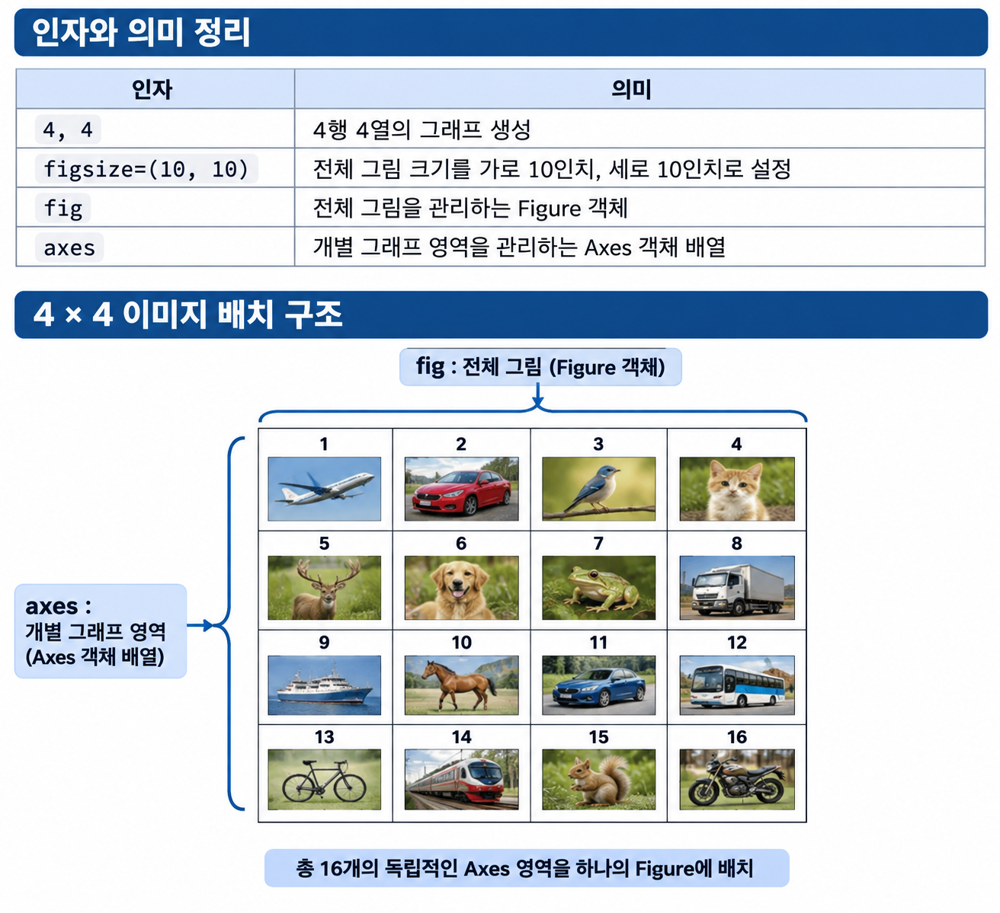
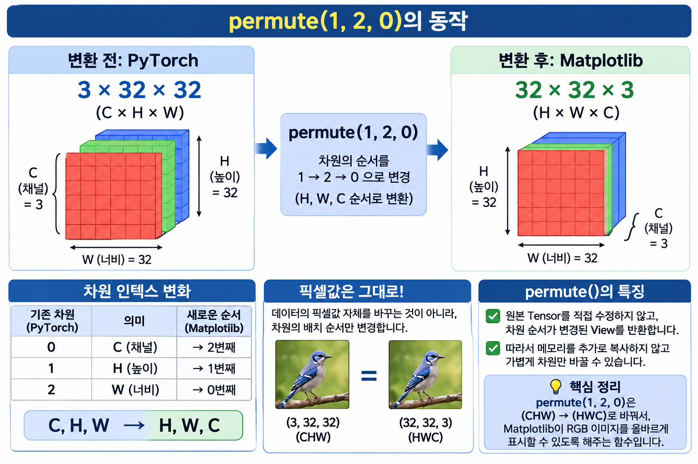

# Python함수에 대한 공부  

## Dataset과 DataLoader의 차이 👉 visualize.py  

| 구분 | Dataset 직접 접근 | DataLoader |
|---|---|---|
| 접근 방식 | `train_dataset[i]` | `next(iter(train_loader))` |
| 데이터 개수 | 지정한 인덱스의 데이터 | Batch 단위 |
| 데이터 형태 | 이미지 1장 | 이미지 여러 장 |
| 주된 목적 | 개별 데이터 확인 | 모델 학습 및 평가 |  

예를 들어,  
 Batch Size가 64라면: 'images, labels = next(iter(train_loader))'
 이때 데이터 형태는 images: [64, 3, 32, 32], labels: [64]  

 반면 Dataset 직접 접근에서는 image: [3, 32, 32], label: 정수 1개  

* 핵심: Dataset은 개별 데이터를 제공하는 역할이고, DataLoader는 Dataset에서 데이터를 가져와 Batch 구성, 셔플, 병렬 로딩 등을 담당하는 역할.  

## plt.subplots(n, n, figsize=(n, n)) 👉 visualize.py  
 · Matplotlib에서 여러 개의 그래프를 하나의 화면에 배치하는 함수  
 · 사용 예: fig, axes = plt.subplots(4, 4, figsize=(10, 10))  
 
 
 
 
  
  * 주의할 점: fig와 axes가 서로 다른 객체임(fig: 전체 도화지 / axes: 도화지 안에 배치된 개별 그림 영역)  

## enumerate() 👉 visualize.py  
 · 이 코드는 Python의 enumerate()와 NumPy 배열의 flat 속성을 함께 사용  
 · 사용 예: for i, ax in enumerate(axes.flat):  
  - 먼저 먼저 axes는 4행 4열의 2차원 배열이라 할때  
   axes =  
   [  
   [ax00, ax01, ax02, ax03],  
   [ax10, ax11, ax12, ax13],  
   [ax20, ax21, ax22, ax23],  
   [ax30, ax31, ax32, ax33]  
   ]  

   그런데 axes.flat을 사용하면 이 배열을 순서대로 펼쳐서 접근할 수 있음  
   ax00 → ax01 → ax02 → ax03  
   ax10 → ax11 → ax12 → ax13  
   ax20 → ax21 → ax22 → ax23  
   ax30 → ax31 → ax32 → ax33  

   여기에 enumerate()를 적용하면 :  
   (0, ax00)  
   (1, ax01)  
   (2, ax02)  
   ...  
   (15, ax33)  

   따라서 다음과 같이 동작함 i: 이미지 인덱스, ax: 해당 이미지를 출력할 그래프 영역  
   즉, 이미지 0번은 첫 번째 영역에, 이미지 15번은 마지막 영역에 출력  

## .permute() 👉 visualize.py  
 · 이미지 차원 순서를 재배치 하는 함수.(코드의 전처리 과정에서 .ToTensor()를 사용하여 HWC → CHW로 재배치한 이미지를 시각화를 위해 원본과 동일한 데이터 배치 형식으로 돌림. 단, 원본 이미지 파일 자체로 복원은 아님, 형식만 돌림)  
 · 사용 예: image = images[i].permute(1, 2, 0)  
 
 
 
 
   

👉 visualize.py 마지막 정리  
| 핵심 코드 | 이해해야 할 개념 |
|---|---|
| `train_dataset[i]` | Dataset 개별 데이터 접근 |
| `images.append(image)` | 리스트에 Tensor 저장 |
| `plt.subplots()` | Figure와 Axes 객체 |
| `enumerate()` | 인덱스와 객체 동시 접근 |
| `axes.flat` | 2차원 배열을 1차원으로 순회 |
| `permute(1, 2, 0)` | Tensor 차원 순서 변경 |
| `imshow()` | 이미지 시각화 |
| `classes[labels[i]]` | 정수 Label을 클래스 이름으로 변환 |
| `.shape` | Tensor 차원 확인 |
| `.min()`, `.max()` | 픽셀값 범위 확인 |
| `[0]`, `[1]`, `[2]` | RGB 채널별 접근 |
| `.mean()` | 픽셀 평균 계산 |
| `.item()` | Tensor 값을 Python 숫자로 변환 |   

